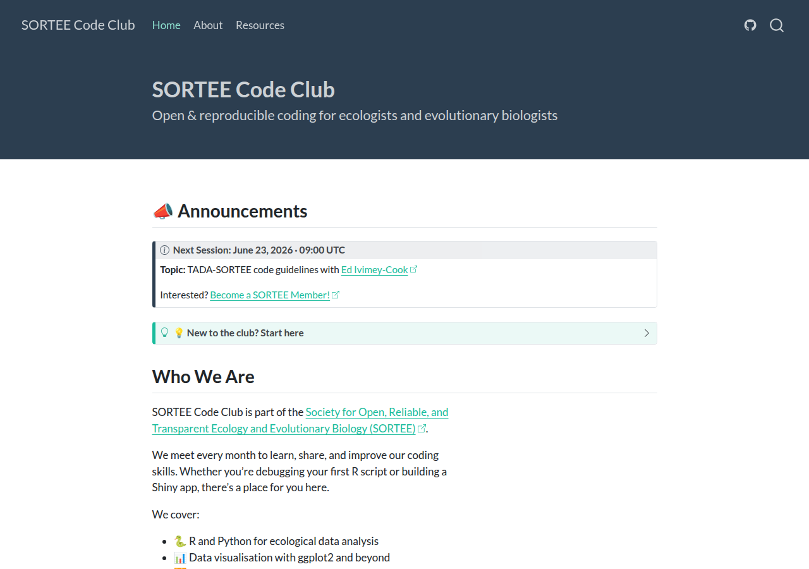
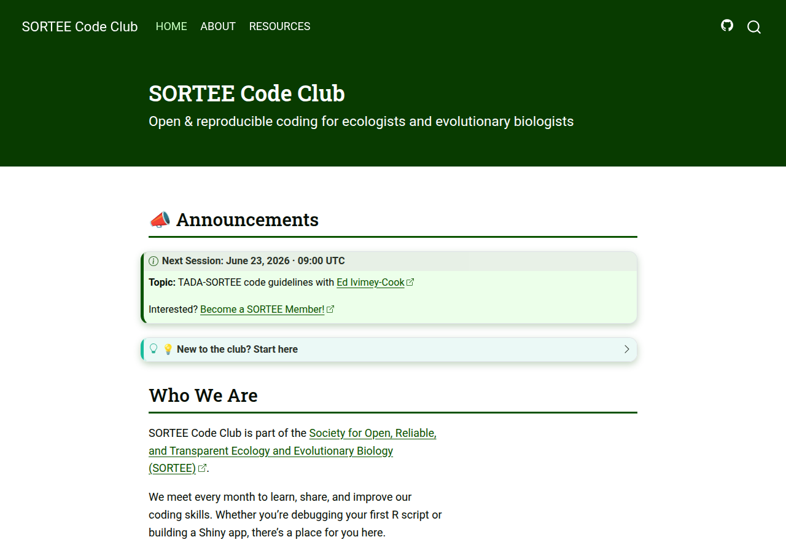

## How to style your own website with Quarto {#title .center}

**CSS and SCSS** · SORTEE Code Club · Part 2

Cecilia Baldoni


## Housekeeping {#housekeeping}

- Be nice to each other! And abide to [SORTEE Code of Conduct](https://sortee.org/codeofconduct/)
- Ask questions any time! Type it in the chat, or use the 'Raise Hand' function.
- Find all materials in the Github Repository: [github.com/SORTEE/CodeClub](https://github.com/SORTEE/CodeClub)

::: {.notes}

:::

## Where we left off {#where}

:::: {.columns}
::: {.column width="50%"}
{fig-alt="The Part 1 website with the default flatly theme: dark blue-grey navbar and title banner, teal links, Lato font."}
:::
::: {.column width="50%" .fragment}
{fig-alt="The same website after today's styles.scss: SORTEE green navbar and banner, Roboto Slab headings with green underlines, a green-tinted note callout."}
:::
::::

[Same `.qmd` files. Only one new file: `styles.scss`.]{.fragment}

## Today

**Agenda:**

1. How is a web page built?
2. CSS: how do I tell the browser what things look like?
3. SCSS: how do I avoid repeating myself?
4. How does Quarto use SCSS?

Slides ~15 min · live coding ~40–45 min · Q&A


## Part 1 · How is a web page built? {.center .section-slide}


## What does a web page need

:::: {.columns}
::: {.column width="50%"}
**HTML** (HyperText Markup Language) says *what is on the page*.

```html
<h2>Who We Are</h2>
```
:::
::: {.column width="50%" .fragment}
**CSS** (Cascading Style Sheets) says *what it looks like*.

```css
h2 { color: #0B5400; }
```
:::
::::
<br><br>
[Each piece of content sits between **tags**: `<h2>…</h2>` is a heading. <br><br> The browser reads both and draws the page.]{.fragment}


## Wait a minute...

:::: {.columns}
::: {.column width="50%"}
{fig-alt="Prince John from Disney's Robin Hood throwing a tantrum, shouting no."}
:::

::: {.column width="50%"}
<br><br>

> Do we need to learn `(S)CSS` AND `HTML`??

:::
::::

## Quarto for the rescue!

Quarto is awesome, because it takes care of everything:

```markdown
::: {.callout-note}
## Next Session
:::
```

Quarto turns it into HTML like this (simplified):

```html
<div class="callout callout-note">
```

<br><br>
[No need to worry about HTML!]{.fragment}


## Part 2 · CSS: how do I tell the browser what things look like? {.center .section-slide}


## A CSS rule, piece by piece

```css
h2 { color: #0B5400; }
```

. . .

1. `h2` is the **selector**: *which* elements? All level-2 headings.

. . .

2. `color` is the **property**: *what* do we change? The text colour.

. . .

3. `#0B5400` is the **value**: change it *to what*? SORTEE green. (A **hex colour**)

. . .

`{ }` hold the instructions <br>
`:` joins property and value <br> 
`;` ends each one.

::: {.notes}
red `0B`, green `54`, blue `00`.
:::

## Selectors: pointing at elements

```css
h2 { … }
.callout-note { … }
.navbar .nav-link { … }
.btn:hover { … }
```

1. `h2`: a **tag name**, no symbol. Picks every `<h2>` heading.
2. `.callout-note`: a **class**, marked by the `.`. Picks every element with that label.
3. `.navbar .nav-link`: two classes, joined by a **space** = "inside". Picks menu links *inside* the navbar.
4. `.btn:hover`: a class plus a **colon** = a *state*. Picks a button, but only while the mouse is over it.

. . .

A class is just a label. Quarto has a few already (e.g. `callout-note`), but we can invent our own!

::: {.notes}
A selector is an address: a tag name, a class with a dot (Quarto's, like callout-note, or one we make up, like my-box), something inside something else with a space, or a state with a colon (.btn:hover is a button only while the mouse is over it; it comes back in the nesting slides). (2 min)
:::

## When two rules disagree: a tie {.smaller}

One heading, two rules that both set its colour. Which one wins?

```html
<h2>Who We Are</h2>
```

```css
h2 { color: #0B5400; }   /* written first */
h2 { color: navy; }      /* written second */
```

. . .

The browser gives every selector a **score**, by counting its parts. Each **tag** (`h2`) = **1 point**.

. . .

| Rule | Parts | Score |
|---|---|---|
| `h2` (first) | one tag = 1 | **1** |
| `h2` (second) | one tag = 1 | **1** |

. . .

A tie: the rule written **later** wins. The heading is **navy**.

. . .

> *Fun fact: that's where the 'Cascading' in CascadingStyleSheet comes in!*


## When two rules disagree: class beats tag {.smaller}

Now the heading has a class, and a class is worth more: each **class** (`.highlight`) = **10 points**. Which rule wins this time?

```html
<h2 class="highlight">Who We Are</h2>
```

```css
.highlight { color: #0B5400; }   /* written first */
h2 { color: navy; }              /* written second */
```

. . .

| Rule | Parts | Score |
|---|---|---|
| `.highlight` | one class = 10 | **10** |
| `h2` | one tag = 1 | **1** |

. . .

**Higher score wins**, so the heading is **green**, even though `h2` comes later. Order only matters on a tie.

::: {.notes}
Most people expect the second rule to win because it comes last. But the browser counts first: a class is worth 10, a tag is worth 1, so the class wins whatever the order. This is why a rule that looks correct sometimes does nothing: another rule has a higher score. In the DevTools demo next, the navy rule has two classes (20) and ours has one (10), so the same counting applies. (2 min)
:::

## DevTools: see the CSS of any page

1. Right-click anything on the page → **Inspect**.
2. **Left panel**: the HTML. Look for `class="…"` to find the labels.
3. **Right panel (Styles)**: every rule that applies. Rules that lost are ~~crossed out~~.
4. You can edit values there to try things out. Nothing is saved.

<div class="demo-note demo">Try it on this box. Which rule lost?</div>


::: {.notes}
DevTools answers "what is this called?" and "why isn't my rule working?", which are the two questions you'll ask most. Live demo: right-click the box, Inspect, and read the Styles panel from the top. Rules are listed from strongest to weakest. The first is .demo-note.demo (navy, score 20); right under it is .demo-note (green, score 10), crossed out because it lost. If you see other crossed-out lines on a different element, they usually come from reveal.js and Quarto's own CSS overriding each other. Say that is normal, and that you only care about the property you are debugging.
:::

## Part 3 · SCSS: how do I avoid repeating myself? {.center .section-slide}

::: {.notes}
Plain CSS works, but it gets repetitive fast. (0.1 min)
:::

## The problem with plain CSS

```css
.navbar { background: #0B5400; }
h2 { color: #0B5400; }
.btn { border-color: #0B5400; }
```


New brand colour? <br><br> You'll need to find and change every copy. 


## What is SCSS?

:::: {.columns}
::: {.column width="40%"}
{.fragment fragment-index=4 fig-alt="Prince John from Disney's Robin Hood throwing a tantrum, shouting no."}
:::
::: {.column width="60%" .nonincremental}
::: {.fragment fragment-index=1}
- **SCSS** (Sassy CSS) is CSS plus a few extras: **variables** and **nesting** (and many more).
:::

::: {.fragment fragment-index=2}
- Any CSS is **already valid** SCSS.
:::

::: {.fragment fragment-index=3}
- Browsers only understand CSS, so SCSS has to be *translated* into CSS with **Sass**.
:::

::: {.fragment fragment-index=5}
- **Quarto does that for you!**
:::
:::
::::

::: {.fragment fragment-index=6 .centered}
`styles.scss` → (Quarto → Sass → CSS) → browser
:::

::: {.notes}
SCSS is a more convenient way to write CSS; Quarto translates it for us (the translator is called Sass, in case they see the name), so we never run anything by hand. Then flag the markers: they look like comments, but Quarto reads them. Without them the file errors, and in the wrong section a variable does nothing. Each snippet from here on starts with the right one, and Part 4 explains why. (1.5 min)
:::

## How does Quarto do that?

**Every SCSS file is split into sections** with a marker comment: <br>

- `/*-- scss:defaults --*/` for variables, 
- `/*-- scss:rules --*/` for rules. 

. . . 

Each snippet from here on starts with its marker. (Why: Part 4.)

## What is a variable?

A **variable** is a name that stores a value. You already use them in R:

```r
sortee_green <- "#0B5400"
```

In SCSS, a variable starts with `$`:

```scss
/*-- scss:defaults --*/
$sortee-green: #0B5400;
$primary: $sortee-green;
```

Change the value once, and everything that uses the name updates.

::: {.notes}
It's the same idea as an R object: give a value a name, then use the name everywhere instead of the value. (1 min)
:::

## Nesting: rules inside rules

CSS: two separate rules

```css
.btn-outline-primary { border-width: 2px; }
.btn-outline-primary:hover { color: #ffffff; }
```

SCSS: one rule inside the other

```scss
/*-- scss:rules --*/
.btn-outline-primary {
  border-width: 2px;
  &:hover { color: #ffffff; }
}
```

`&` means "the selector I'm inside", so `&:hover` = `.btn-outline-primary:hover`.

::: {.notes}
Nesting keeps rules about the same thing together; Quarto unfolds it back into the two plain CSS rules. (1 min)
:::

## Nesting, things inside things

CSS: the parent name is repeated every time

```css
.navbar { background: #0B5400; }
.navbar .nav-link { color: white; }
.navbar .nav-link:hover { text-decoration: underline; }
```

SCSS: write the parent once

```scss
/*-- scss:rules --*/
.navbar {
  background: #0B5400;
  .nav-link {
    color: white;
    &:hover { text-decoration: underline; }
  }
}
```

A rule with no `&` inside another means "an element **inside** it": `.nav-link` becomes `.navbar .nav-link`.

::: {.notes}
Same idea, but now with descendants. The nesting mirrors the HTML: nav links live inside the navbar, so their rules live inside the navbar's rule. Note the two levels: .nav-link is inside .navbar, and &:hover is inside .nav-link. (1 min)
:::

## Nesting, variants of the same thing {.smaller}

CSS: every variant repeats the full name

```css
.callout { border-left-width: 6px; }
.callout.callout-note { border-left-color: #0B5400; }
.callout-note .callout-title { font-weight: 600; }
```

SCSS: `&` also glues a class onto the parent

```scss
/*-- scss:rules --*/
.callout {
  border-left-width: 6px;
  &.callout-note {
    border-left-color: #0B5400;
    .callout-title { font-weight: 600; }
  }
}
```

`&.callout-note` has **no space**: it's the *same* element with both classes. `.callout-title` **with** a space is an element *inside*.

::: {.notes}
The one thing to get right: no space after & means same element (callout AND callout-note); a space means a descendant. Compare with the earlier specificity slide: this compiles to a selector that scores 20, so it could beat a lone class. Don't over-nest: more than 2-3 levels gets hard to read, and every level makes the selector more specific. (1.5 min)
:::

## Part 4 · How does Quarto use SCSS? {.center .section-slide}


## Quarto comes with ready-made themes

Render a website and it already looks styled. Why?

- Quarto has a collection of **pre-made themes**: `flatly`, `cosmo`, `darkly`, ...
- A theme is a set of values for **variables** like `$primary` (the main colour).

. . .

Our Part 1 site already uses one: `theme: flatly`.

::: {.notes}
Nothing on a Quarto page is unstyled: the look comes from the theme. A theme is mostly a set of values for variables, which is the key to today: change a variable and everything built from it changes. (1 min)
:::

## Today: we write on top of flatly

`theme: [flatly, styles.scss]`

- `flatly` is applied first.
- `styles.scss` is **ours**, applied after it.

. . .

Wherever both say something, **ours wins**. Anything we don't mention stays as flatly made it.

**You never edit flatly.** You only add a small file after it.

::: {.notes}
Quarto applies the files in the theme list in order. flatly comes first, our file comes after and overrides some of its values. That is why styles.scss can stay short: it only contains what we want to be different. Setting a variable is the gentle way (the theme uses it everywhere); writing a rule is the blunt way (only that one thing changes). Next: how that file is built. (1.5 min)
:::

## Two sections: `defaults` and `rules` {.smaller}

Quarto reads your file in **two pieces**, and puts each in a different place:

```scss
/*-- scss:defaults --*/
$primary: #0B5400;            // variables

/*-- scss:rules --*/
h2 { color: $primary; }       // CSS rules
```

| Marker | What goes in | Where Quarto puts it |
|---|---|---|
| `/*-- scss:defaults --*/` | **variables** (`$primary: …`) | **before** the theme is built |
| `/*-- scss:rules --*/` | **CSS rules** (`h2 { … }`, nesting) | **after** the theme's CSS, so yours come later |

. . .

**Why it matters**

- A variable under `rules` is set too late: the theme has already used its own value. **Nothing happens, no error.**
- A rule under `defaults` lands before the theme's CSS, so the theme can override it.
- No markers at all: Quarto stops with an error.

You can repeat a marker as often as you like. Quarto collects all the `defaults` pieces together, and all the `rules` pieces together.


## Our file: `styles.scss`

In `_quarto.yml`: `theme: [flatly, styles.scss]`

```scss
/*-- scss:defaults --*/
$sortee-green: #0B5400;
$primary: $sortee-green;

/*-- scss:rules --*/
h2 { border-bottom: 3px solid $primary; }
```

This is the file we build today, one step at a time: **variables first, then rules**, each under its own marker.

::: {.notes}
The two markers are the ones from the previous slide. We start with a nearly empty file and add one piece at a time, rendering after each. (1 min)
:::

## Variables we'll set today {.smaller}

::: {.nonincremental}
:::: {.columns}
::: {.column width="30%"}
**Colour**

- `$sortee-green`
- `$primary`
- `$secondary`
- `$body-bg`
- `$body-color`
- `$link-color`
- `$link-hover-color`
:::
::: {.column width="35%"}
**Typography**

- `$font-family-sans-serif`
- `$headings-font-family`
- `$headings-font-weight`
- `$h1h2h3-font-weight`
- `$font-size-root`
- `$line-height-base`
:::
::: {.column width="35%"}
**Quarto components**

- `$navbar-bg`
- `$navbar-fg`
- `$navbar-hl`
- `$footer-bg`
- `$footer-fg`
- `$callout-color-note`
- `$code-block-bg`
- `$code-block-border-left`

**Shape**

- `$border-radius`
- `$btn-border-radius`
:::
::::
:::

::: {.notes}
You don't need to memorise these; they are all in the reference file, with a comment for each. (0.5 min)
:::

## Go further


What we skipped: `position`, flexbox and grid, media queries, partials and `@use`, dark mode.

- [Quarto: customizing themes](https://quarto.org/docs/output-formats/html-themes.html#customizing-themes)
- [SCSS basics (Sass guide)](https://sass-lang.com/guide/)
- [MDN: CSS](https://developer.mozilla.org/en-US/docs/Web/CSS)
- [CSS & SCSS, from scratch](https://cecibaldoni.github.io/content/css-scss-scrolly.html)


## Follow along {#follow-along .smaller}

::: {.nonincremental}
1. **Download**: [github.com/SORTEE/CodeClub](https://github.com/SORTEE/CodeClub) → green **Code** → **Download ZIP** → unzip
2. **Copy** the folder `20260519_WebsiteQuarto` and open it in RStudio or VS Code
3. **Terminal**: run `quarto preview`
4. **Edit and save**: the browser updates live

Used Git before? `git clone https://github.com/SORTEE/CodeClub.git`
:::

Full steps and troubleshooting: `handout.md` in the repo.